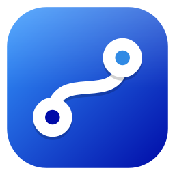
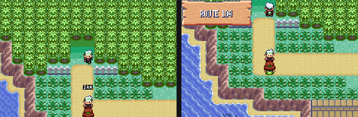
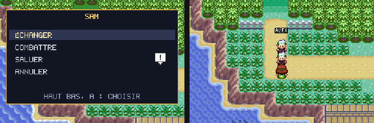
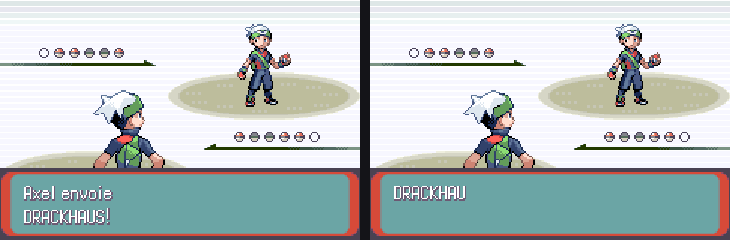

<h1 align="center">Coop Link</h1>

<i>Anciennement Pokémon Co-op</i>

**Joue aux Pokémon classiques avec tes amis : on se voit sur la carte, on échange, on se combat en vrai 1 contre 1 en ligne et on rejoint un ami, sur 28 jeux de la Game Boy à la 3DS.**

[English](README.md) | Français

*Deux joueurs dans Pokémon Émeraude, chacun sur son propre jeu : ils se voient (noms au-dessus de la tête), le menu A propose Échanger, Combattre, Saluer, puis un vrai combat 1 contre 1 démarre. Capturé hors écran dans le labo de test.*

> **Projet de fans, sans lien avec Nintendo, Game Freak, Creatures ni The Pokémon Company, qui ne l'approuvent pas.**
> Pokémon est une marque de ses propriétaires. **Aucune ROM, aucun BIOS, aucun firmware, aucune clé de chiffrement et aucune sauvegarde n'est fournie, liée ou distribuée ici.** Tu utilises tes propres jeux, acquis légalement.

## Ce que c'est

Un lanceur (Windows, macOS Apple Silicon, Linux x86_64) qui fait tourner tes propres copies des Pokémon classiques dans des émulateurs modifiés et relie jusqu'à 8 joueurs dans un même salon. Chacun joue sa propre sauvegarde et sa propre histoire ; les mods placent les autres joueurs dans ton monde et ajoutent les fonctions multijoueur qui manquent.

- **Se voir** : les amis apparaissent sur ta carte avec leur nom, leur marche et (dans la plupart des jeux) leur apparence.
- **Échanger** : face à un ami, A puis **Échanger**. Le Pokémon change de main sur place, évolutions par échange comprises.
- **Combattre** : face à un ami, A puis **Combattre**. Un vrai 1 contre 1, chacun choisit ses attaques et ses remplaçants, rien n'en reste après (pas d'expérience, pas d'argent perdu, l'équipe revient comme avant).
- **Rejoindre** : L et R maintenus, choisis un ami, et tu arrives à côté de lui (seulement dans un lieu déjà visité).
- **Personnaliser** : randomiseur et « code de partie » pour que l'ami ait le même jeu, rééquilibrage, patchs, introduction passée, sauvegardes séparées avec copies automatiques, infos de combat (efficacité et dégâts estimés sur DS), mises à jour automatiques.
- **Amis** : crée un compte dans le lanceur, ajoute tes amis par leur pseudo et vois qui est en ligne, depuis quand, et à quoi il joue.
- **Mods ajoutables en cours de partie** : Nuzlocke / Soul Link à deux, niveau plafond, roulette, blackjack.

## Jeux et fonctions

| Génération | Jeux | Émulateur | Se voir | Échanger | Vrai combat 1v1 | Rejoindre |
|---|---|---|:-:|:-:|:-:|:-:|
| 1 et 2 (Game Boy) | Rouge, Bleu, Jaune, Or, Argent, Cristal | mGBA | oui | oui | oui | expérimental |
| 3 (GBA) | Rubis, Saphir, Émeraude, Rouge Feu, Vert Feuille | mGBA | oui | oui | oui | oui |
| 4 (DS) | Diamant, Perle, Platine, HeartGold, SoulSilver | melonDS | oui | oui | oui | oui |
| 5 (DS) | Noire, Blanche, Noire 2, Blanche 2 | melonDS | oui | oui | oui | oui |
| 6 (3DS) | X, Y, Rubis Oméga, Saphir Alpha | Azahar | oui | oui | oui | oui |
| 7 (3DS) | Soleil, Lune, Ultra-Soleil, Ultra-Lune | Azahar | oui, avec le vrai modèle 3D de l'ami | oui | oui | oui |

Remarques :

- Un vrai 1 contre 1 demande deux jeux de la même famille : par exemple Noire avec Blanche, Noire 2 avec Blanche 2, Soleil avec Lune, Ultra-Soleil avec Ultra-Lune. Entre familles différentes, le combat est l'équipe de l'autre menée par le jeu.
- Des jeux de générations différentes peuvent partager un salon, mais n'interagissent qu'avec ceux qu'ils peuvent : l'échange se fait entre la même génération.
- Tout le monde dans un salon doit avoir la **même version du lanceur**. Les versions Windows peuvent arriver quelques jours après celles de macOS et de Linux : vérifie le numéro avant de jouer.
- Développé et testé avec des dumps européens (français) pour les jeux Game Boy et GBA. D'autres langues ou régions peuvent ne pas marcher.

### Pokémon Donjon Mystère (début de prise en charge)

Équipe de Secours Rouge et Bleue, Explorateurs du Temps, de l'Ombre et du Ciel, Les Portes de l'Infini et Méga Donjon Mystère : on voit ses amis dans la base, au village et dans les donjons, et tous ceux d'un même donjon ont les mêmes étages. Pas d'échange ni de combat dans ces jeux. Cette partie est en pause : l'ami au village des deux jeux 3DS n'a jamais été vu fonctionner.

## Installer en 3 étapes

1. **Télécharge** le lanceur de ton système (boutons ci-dessus), décompresse-le et lance-le (Windows : `Pokemon Coop.exe` ; macOS : glisse l'app dans Applications, clic droit puis Ouvrir la première fois ; Linux : `tar -xzf Pokemon-Coop-Linux.tar.gz` puis lance `Pokemon Coop`).
2. **Ajoute tes propres jeux** : mets dans la bibliothèque du lanceur les fichiers ROM tirés de tes propres cartouches et disques (fichiers seuls, archives ou dossier entier). Les jeux 3DS doivent être des dumps déchiffrés.
3. **Joue** : crée une partie, clique sur **Héberger**, envoie le code du salon à tes amis, qui cliquent sur **Rejoindre** et le tapent. Jusqu'à 8 joueurs. Tous doivent avoir la même version du lanceur.

## FAQ

**Où trouver les jeux ?**
Dans tes propres cartouches et disques. Ce projet ne fournit, n'héberge, ne lie ni n'aide à trouver aucune ROM, aucun BIOS, aucun firmware ni aucune clé, et les demandes de ce genre ne sont pas les bienvenues dans les issues. Extraire les jeux que tu possèdes relève de toi et de la loi de ton pays.

**C'est gratuit ?**
Oui.

**Faut-il ouvrir des ports ou avoir une très bonne connexion ?**
Les joueurs se rejoignent par un code de salon à travers un relais, donc aucune redirection de port. La plupart des essais ont été faits avec plusieurs instances sur une même machine par le vrai relais : signale les problèmes entre vraies machines.

**Quelle version doivent avoir mes amis ?**
La même que toi. Le lanceur propose les mises à jour une fois par jour.

**Ça modifie ma ROM ?**
Non, les jeux tournent tels quels. Les émulateurs lisent la mémoire du jeu et dessinent tes amis. Seules les options que tu choisis (rééquilibrage, randomiseur, patchs) créent une copie modifiée pour cette partie.

**Ça marche seulement sous Windows ?**
Non : Windows 10/11, macOS sur Apple Silicon et Linux x86_64 (Ubuntu 22.04 ou plus récent et équivalents).

**Je peux jouer avec quelqu'un sur un autre système ?**
Oui, tant que les versions du lanceur sont identiques.

**Quelque chose ne marche pas.**
Ouvre une issue avec ton système, la version du lanceur, le jeu et ce qui s'est passé. Ne joins ni ROM ni sauvegarde.

## Crédits et licences

Coop Link repose sur trois émulateurs libres, modifiés pour le multijoueur :

- [melonDS](https://github.com/melonDS-emu/melonDS) (Nintendo DS), GPL v3, avec le fork Project PM comme base.
- [mGBA](https://github.com/mgba-emu/mgba) (Game Boy et Game Boy Advance), MPL 2.0.
- [Azahar](https://github.com/azahar-emu/azahar) (Nintendo 3DS), GPL v2, un fork de la lignée Citra.

Les sources modifiées de ces émulateurs sont jointes à chaque version Windows (`sources-mods-...zip`, `melonds-coop-...zip`) et les textes des licences sont dans le dossier `licences` de chaque paquet. Merci aux auteurs de ces projets, et à la communauté du ROM hacking et des projets de décompilation (pret et autres) dont la documentation a rendu possibles les cartes mémoire. Le randomiseur est piloté par l'Universal Pokemon Randomizer ZX.

Ce dépôt ne contient que les téléchargements, cette page et le workflow de compilation macOS et Linux. Projet de fans, sans usage commercial, sans affiliation.
