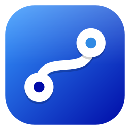
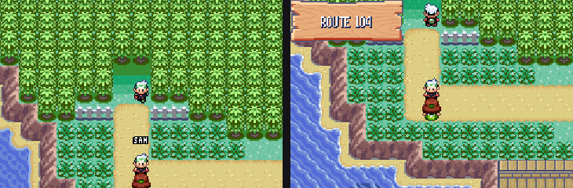
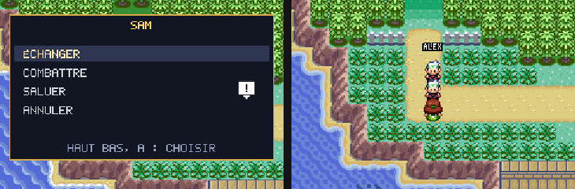
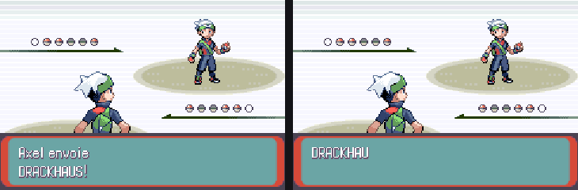

<h1 align="center">Coop Link</h1>

<i>Formerly Pokemon Co-op</i>

**Play the classic Pokemon games together with friends: see each other on the map, trade, fight real 1v1 battles online and join a friend, in 28 games from Game Boy to 3DS.**

English | [Français](README.fr.md)

*Two players in Pokemon Emerald, each on their own game: they see each other (names above their heads), the A menu offers Trade, Battle, Greet, then a real 1v1 battle starts. Captured headless from the test lab.*

> **Fan project. Not affiliated with, endorsed by or connected to Nintendo, Game Freak, Creatures or The Pokemon Company.**
> Pokemon is a trademark of its owners. **No ROM, no BIOS, no firmware, no encryption key and no save file is included, linked or distributed here.** You use your own legally owned games.

## What it is

A launcher (Windows, macOS Apple Silicon, Linux x86_64) that runs your own copies of the classic Pokemon games in modified emulators and connects up to 8 players in one room. Everybody plays their own save and their own story; the mods put the other players in your world and add the missing multiplayer features.

- **See each other**: friends appear on your map with their name, their walking animation and (in most games) their look.
- **Trade**: face a friend, press A, pick **Trade**. The Pokemon changes hands on the spot, including trade evolutions.
- **Battle**: face a friend, press A, pick **Battle**. A real 1v1, each player choosing their own moves and switches, nothing kept afterwards (no XP, no money lost, your team comes back as before).
- **Join**: hold L and R, pick a friend, and you are taken next to them (only to places you have already visited).
- **Make the game yours**: randomizer and "game code" so your friend gets the same game, rebalancing, patches, intro skip, separate saves with automatic backups, battle info (type effectiveness and estimated damage on DS), automatic updates.
- **Friends**: create an account in the launcher, add friends by their name and see who is online, since when, and what they are playing.
- **Mods you can add to a running game**: two-player Nuzlocke / Soul Link, level cap, roulette, blackjack.

## Games and features

| Generation | Games | Emulator | See each other | Trade | Real 1v1 battle | Join a friend |
|---|---|---|:-:|:-:|:-:|:-:|
| 1 and 2 (Game Boy) | Red, Blue, Yellow, Gold, Silver, Crystal | mGBA | yes | yes | yes | experimental |
| 3 (GBA) | Ruby, Sapphire, Emerald, FireRed, LeafGreen | mGBA | yes | yes | yes | yes |
| 4 (DS) | Diamond, Pearl, Platinum, HeartGold, SoulSilver | melonDS | yes | yes | yes | yes |
| 5 (DS) | Black, White, Black 2, White 2 | melonDS | yes | yes | yes | yes |
| 6 (3DS) | X, Y, Omega Ruby, Alpha Sapphire | Azahar | yes | yes | yes | yes |
| 7 (3DS) | Sun, Moon, Ultra Sun, Ultra Moon | Azahar | yes, with the real 3D model of your friend | yes | yes | yes |

Notes:

- A real 1v1 needs two games of the same family: for example Black with White, Black 2 with White 2, Sun with Moon, Ultra Sun with Ultra Moon. Between different families, the battle is the other player's team played by the game.
- Games from different generations can share a room, but they only interact with the games they can: trading is between the same generation.
- Everybody in a room must run the **same launcher version**. Windows builds can arrive a few days after the macOS and Linux ones, so check the version number before you play.
- Developed and tested with European (French) dumps of the Game Boy and GBA games. Other languages and regions may not work.

### Pokemon Mystery Dungeon (early support)

Red and Blue Rescue Team, Explorers of Time / Darkness / Sky, Gates to Infinity and Super Mystery Dungeon: you see your friends in the base, the village and the dungeons, and everyone in the same dungeon gets the same floors. No trading or battling in these games. This part is paused for now: the friend in the village of the two 3DS games has never been seen working.

## Install in 3 steps

1. **Download** the launcher for your system (buttons above), unzip it and start it (Windows: `Pokemon Coop.exe`; macOS: drag the app to Applications, right-click, Open the first time; Linux: `tar -xzf Pokemon-Coop-Linux.tar.gz` then run `Pokemon Coop`).
2. **Add your own games**: drop the ROM files you dumped from your own cartridges and discs into the launcher (the launcher library takes single files, archives, or a whole folder). 3DS games must be decrypted dumps.
3. **Play**: create a game, click **Host**, send the room code to your friends, who click **Join** and type it. Up to 8 players. Everyone needs the same launcher version.

## FAQ

**Where do I find the games?**
In your own cartridges and discs. This project does not provide, host, link to or help find ROMs, BIOS files, firmware or encryption keys, and questions asking for them are not welcome in the issues. Dumping the games you own is up to you and to the law of your country.

**Is it free?**
Yes.

**Do I need a good internet connection or open ports?**
Players join through a room code over a relay server, so no port forwarding is needed. Most testing so far was done with several instances on one machine through the real relay, so please report problems between real machines.

**Which version should my friends use?**
The same as you. Updates are offered inside the launcher once a day.

**Does it change my ROM?**
No, the games run as they are. The emulators read the game memory and draw your friends. Only the options you choose (rebalancing, randomizer, patches) create a modified copy for that game.

**Does it work on Windows only?**
No: Windows 10/11, macOS on Apple Silicon and Linux x86_64 (Ubuntu 22.04 or newer and equivalents).

**Can I play with someone who is on another system?**
Yes, as long as the launcher versions match.

**Something is broken.**
Open an issue with your system, the launcher version, the game, and what happened. Do not attach ROMs or saves.

## Credits and licenses

Coop Link stands on the shoulders of three open source emulators, modified for multiplayer:

- [melonDS](https://github.com/melonDS-emu/melonDS) (Nintendo DS), GPL v3, with the Project PM fork as a base.
- [mGBA](https://github.com/mgba-emu/mgba) (Game Boy and Game Boy Advance), MPL 2.0.
- [Azahar](https://github.com/azahar-emu/azahar) (Nintendo 3DS), GPL v2, a fork of the Citra lineage.

The modified sources of these emulators are attached to each Windows release (`sources-mods-...zip`, `melonds-coop-...zip`) and the license texts are in the `licenses` folder of every package. Thanks to the authors of these projects, and to the community of ROM hacking and decompilation projects (pret and others) whose documentation made the memory maps possible. The randomizer is driven through the Universal Pokemon Randomizer ZX.

This repository only holds the downloads, this page and the build workflow for macOS and Linux. Fan project, no commercial use, no affiliation.
